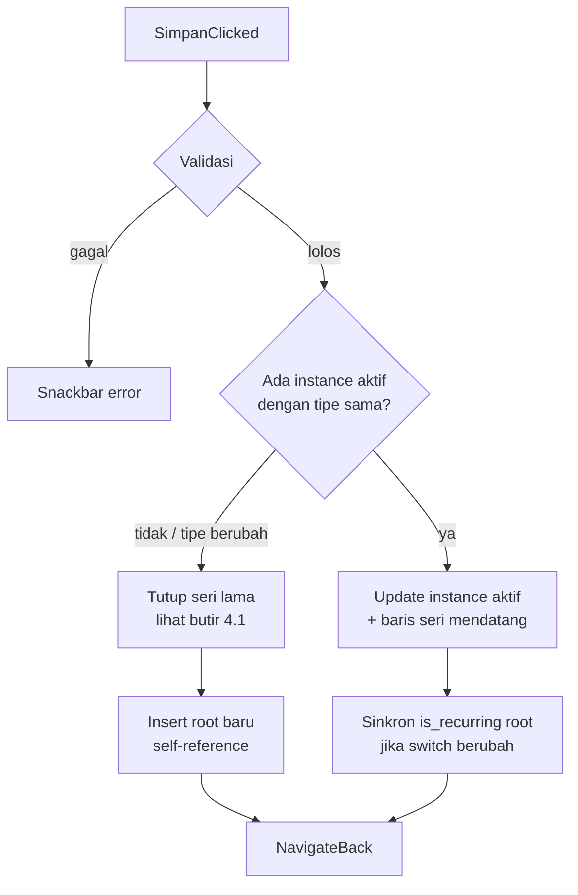
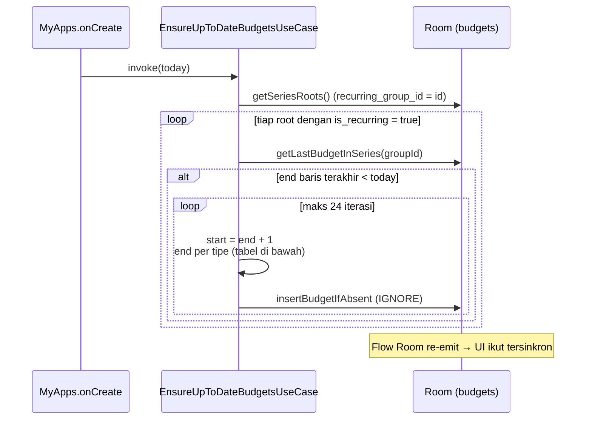
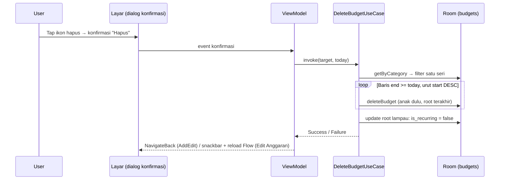

# Spesifikasi: Anggaran Berulang (Recurring Budget)

Dokumen aturan bisnis fitur budget recurring. Keputusan arsitektur di balik aturan ini ada di
[ADR-001](adr/001-recurring-budget-series-instance.md).

## 1. Gambaran Umum

Anggaran dibuat per **seri**. Setiap periode dalam seri disimpan sebagai satu baris (*instance*)
di tabel `budgets`, dihubungkan lewat `recurring_group_id`:

```
root (recurring_group_id = id sendiri)
 ├── instance periode 2
 ├── instance periode 3
 └── ...
```

Seri tidak digenerate otomatis di latar belakang. Saat aplikasi dibuka, sistem memastikan setiap
seri memiliki instance yang mencakup hari ini (**lazy generation**).

## 2. Tipe Periode

| Tipe | Window saat create/edit | Berulang? | Tanggal bisa diedit user? |
|---|---|---|---|
| `MONTHLY` | 1 .. akhir bulan kalender yang mencakup hari ini | Selalu | Tidak (readonly) |
| `WEEKLY` | Minggu locale yang mencakup hari ini | Selalu | Tidak (readonly) |
| `CUSTOM` | Sesuai pilihan user (`mulai` .. `akhir`) | Sesuai switch (default on) | Ya |

Aturan tambahan:

- **Durasi** ditampilkan dinamis: `Durasi N Hari` dihitung dari `akhir - mulai + 1`.
- Preview teks berulang berbeda per tipe:
  - MONTHLY: "…secara otomatis pada tanggal 1 setiap bulannya."
  - WEEKLY: "…secara otomatis setiap awal minggu."
  - CUSTOM: "…secara otomatis setiap N hari sejak `<mulai>`."

## 3. Validasi Simpan

Simpan **ditolak** (Snackbar muncul, tidak ada data tersentuh) bila:

1. `categoryId` kosong/tidak ditemukan → *"Kategori tidak ditemukan"*
2. `amount <= 0` → *"Batas anggaran harus lebih dari 0"*
3. `CUSTOM` dengan `akhir <= mulai` → *"Tanggal berakhir harus setelah tanggal mulai"*

## 4. Alur Simpan



### 4.1 Menutup seri lama (create / ganti tipe)

Dilakukan pada seluruh baris kategori terkait terhadap `windowStart` seri baru:

| Kondisi baris lama | Aksi |
|---|---|
| `start >= windowStart` | **Hapus** — urut `start DESC` (anak duluan, root terakhir demi FK RESTRICT) |
| `start < windowStart` dan `end >= windowStart` | **Potong**: `end = windowStart - 1`, `is_recurring = false` |
| `end < windowStart` (riwayat) | Tidak disentuh |

Semua root seri yang tersentuh mendapat `is_recurring = false` → generasi berhenti.

### 4.2 Update saat tipe sama

- Instance aktif: `amount`, `isRecurring` diperbarui; **window tersimpan tidak diubah**.
- Baris seri lain dengan `start >= start instance aktif` (periode mendatang): `amount` ikut
  diperbarui → konsisten dengan hasil generate berikutnya.
- Riwayat (`start < instance aktif`): **tidak pernah** diubah.

## 5. Lazy Generation (`EnsureUpToDateBudgetsUseCase`)

Dipanggil sekali saat aplikasi dibuka (`MyApps.onCreate`, background scope) dan juga saat
form add/edit budget dibuka.



### Periode berikutnya

| Tipe | Start | End |
|---|---|---|
| MONTHLY | `end + 1 hari` | akhir bulan kalender dari start |
| WEEKLY | `end + 1 hari` | `start + 6 hari` |
| CUSTOM | `end + 1 hari` | `start + interval` (durasi root) |

- `amount` **disalin dari baris terakhir** → edit limit di tengah periode diwarisi otomatis.
- Insert memakai `IGNORE` → aman dijalankan berulang (idempoten).
- Safety cap **24 periode per run**; run berikutnya melanjutkan dari baris terakhir.
- Root dengan `is_recurring = false` (one-shot / sudah ditutup) dilewati.
- Jika `end <= start` (data tidak valid), generate berhenti untuk seri tersebut.

## 6. Migrasi Data

Room v1 → v2 (`DatabaseModule.MIGRATION_1_2`):

```sql
UPDATE budgets SET recurring_group_id = id WHERE recurring_group_id IS NULL
```

Tanpa migrasi ini, root legacy `NULL` tidak terlindungi unique index `(recurring_group_id, start_date)`.

## 7. Edge Case yang Ditangani

| Kasus | Penanganan |
|---|---|
| App dibuka 2× berturut-turut | Insert IGNORE → tidak ada duplikat |
| Root punya anak, generate ulang | REPLACE dilarang (FK RESTRICT); pakai IGNORE |
| User edit saat periode sedang berjalan | Instance aktif + mendatang di-update; riwayat aman |
| Ganti MONTHLY → WEEKLY | Seri lama ditutup (potong/hapus), root baru dibuat |
| Seri basi bertahun-tahun | Cap 24/run; run berikutnya melanjutkan |
| Weekly locale bergeser | Generate meng-anchor start = end + 1 (bukan selarasan locale) |
| Dua seri beda pada kategori sama | Dicegah `closeSeries()` saat create (bukan oleh index) |

## 8. Hapus Anggaran (Tutup Seri)

**Keputusan: "hapus" = tutup seri, bukan hapus semua riwayat.** Budget adalah data
perencanaan; data ledger (`transactions`) tidak pernah disentuh, dan periode lampau
tetap dipertahankan sebagai riwayat alokasi.

Aturan (`DeleteBudgetUseCase`):

1. Baris dalam seri target dengan `end >= today` → **dihapus** (instance aktif +
   seluruh periode mendatang), urut `start DESC` supaya anak terhapus sebelum root
   (FK RESTRICT).
2. Baris lampau (`end < today`) → **dipertahankan**, tetapi `is_recurring` root
   dimatikan supaya `EnsureUpToDateBudgetsUseCase` tidak menghidupkan periode lagi.
3. Seri lain (termasuk seri lain pada kategori yang sama) tidak tersentuh —
   filter berbasis `recurring_group_id`.

Titik masuk (keduanya wajib konfirmasi dialog):

| Layar | Aksi | Cakupan |
|---|---|---|
| `AddEditBudgetScreen` | Ikon 🗑 di TopAppBar (hanya saat budget sudah ada) | Seri instance aktif |
| `EditPresentageBudgetScreen` | Ikon 🗑 per kartu kategori | Seri kategori terkait di periode terpilih |



## 9. Pengujian

Jalankan:

```bash
./gradlew :app:testDebugUnitTest
```

Cakupan (23 unit test, JUnit Jupiter):

| File | Fokus |
|---|---|
| `core/datasource/local/mapper/BudgetMapperTest.kt` | Self-reference root, roundtrip, update id/group |
| `feature/budgets/domain/usecase/EnsureUpToDateBudgetsUseCaseTest.kt` | Rollover bulanan, idempoten, warisan amount, cap 24, interval custom, weekly +1, one-shot skip |
| `feature/budgets/domain/usecase/SaveBudgetUseCaseTest.kt` | Validasi, create root, update tipe-sama, tutup+ganti tipe, urutan hapus FK, custom one-shot |
| `feature/budgets/domain/usecase/DeleteBudgetUseCaseTest.kt` | Tutup seri (FK order), riwayat aman + generasi berhenti, one-shot, isolasi antar seri, target tidak valid |

`FakeBudgetRepository` (di folder test yang sama) meniru perilaku mapper + `IGNORE` Room dan
mencatat urutan delete untuk memverifikasi constraint FK.
